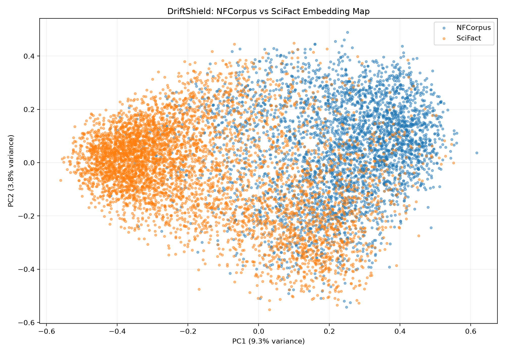
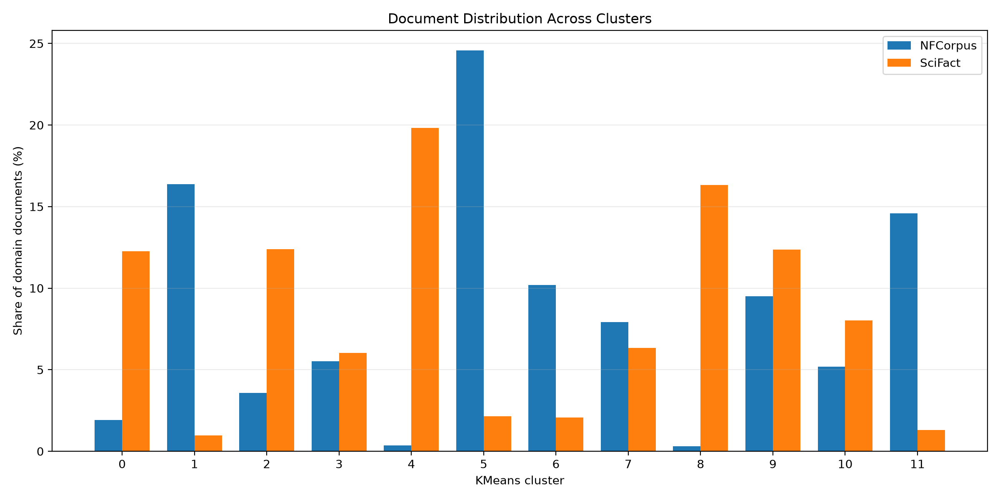

# DriftShield Phase 2: Fingerprint Analysis

## Objective

Characterize differences between NFCorpus (before/reference) and SciFact (after/comparison) using saved document embeddings.

## Dataset and methodology

- NFCorpus documents: 3,633
- SciFact documents: 5,183
- Embedding dimensions: 384
- Total clustered documents: 8,816
- Embedding model used by the existing pipeline: `all-MiniLM-L6-v2`.
- Document text is aligned to embeddings using saved document IDs.
- PCA with two components is used for visualization.
- KMeans uses 12 clusters, random_state=0, and n_init=10.
- Top terms are ranked by mean TF-IDF within each cluster.

## Embedding map

## Cluster shares

## Cluster results

| Cluster | Total | NFCorpus | SciFact | NFCorpus within cluster (%) | SciFact within cluster (%) | NFCorpus domain share (%) | SciFact domain share (%) | Difference (pp) | Top terms |
|---:|---:|---:|---:|---:|---:|---:|---:|---:|---|
| 0 | 705 | 70 | 635 | 9.93 | 90.07 | 1.93 | 12.25 | 10.32 | cells, immune, cell, il, inflammatory, infection, mice, responses, activation, antigen |
| 1 | 645 | 595 | 50 | 92.25 | 7.75 | 16.38 | 0.96 | -15.41 | antioxidant, effects, human, compounds, extract, effect, acid, dietary, activity, tea |
| 2 | 772 | 130 | 642 | 16.84 | 83.16 | 3.58 | 12.39 | 8.81 | cancer, tumor, cells, cell, expression, tumors, growth, human, patients, cancer cells |
| 3 | 512 | 200 | 312 | 39.06 | 60.94 | 5.51 | 6.02 | 0.51 | patients, risk, coronary, cardiovascular, disease, heart, 95, blood, artery, pressure |
| 4 | 1040 | 13 | 1027 | 1.25 | 98.75 | 0.36 | 19.81 | 19.46 | dna, gene, protein, genome, genes, rna, cells, chromatin, transcription, proteins |
| 5 | 1004 | 893 | 111 | 88.94 | 11.06 | 24.58 | 2.14 | -22.44 | diet, intake, dietary, consumption, fat, food, risk, study, weight, health |
| 6 | 477 | 370 | 107 | 77.57 | 22.43 | 10.18 | 2.06 | -8.12 | cancer, risk, breast, breast cancer, 95, ci, women, 95 ci, cancer risk, intake |
| 7 | 617 | 288 | 329 | 46.68 | 53.32 | 7.93 | 6.35 | -1.58 | infection, patients, malaria, disease, infections, transmission, virus, prevalence, hiv, children |
| 8 | 857 | 11 | 846 | 1.28 | 98.72 | 0.30 | 16.32 | 16.02 | cells, cell, stem, stem cells, expression, neurons, protein, differentiation, signaling, embryonic |
| 9 | 986 | 345 | 641 | 34.99 | 65.01 | 9.50 | 12.37 | 2.87 | patients, treatment, study, health, care, results, clinical, use, years, age |
| 10 | 604 | 188 | 416 | 31.13 | 68.87 | 5.17 | 8.03 | 2.85 | insulin, mice, obesity, metabolic, induced, glucose, adipose, increased, metabolism, protein |
| 11 | 597 | 530 | 67 | 88.78 | 11.22 | 14.59 | 1.29 | -13.30 | exposure, concentrations, fish, food, samples, levels, products, consumption, human, meat |

## Interpretation

Clusters with positive domain-share differences are relatively more represented in SciFact; negative differences indicate relatively greater NFCorpus representation.

- Cluster 5 has a domain-share difference of -22.44 percentage points toward NFCorpus. Representative terms: diet, intake, dietary, consumption, fat, food, risk, study, weight, health.
- Cluster 4 has a domain-share difference of 19.46 percentage points toward SciFact. Representative terms: dna, gene, protein, genome, genes, rna, cells, chromatin, transcription, proteins.
- Cluster 8 has a domain-share difference of 16.02 percentage points toward SciFact. Representative terms: cells, cell, stem, stem cells, expression, neurons, protein, differentiation, signaling, embryonic.

These clusters describe differences in embedding-space representation. They do not establish that domain drift caused a change in retrieval performance.

## Reproducibility

Run `python fingerprints.py` from the repository directory. Required packages include numpy, pandas, matplotlib, scikit-learn, and datasets.

The CSV contains the complete per-cluster statistics.
